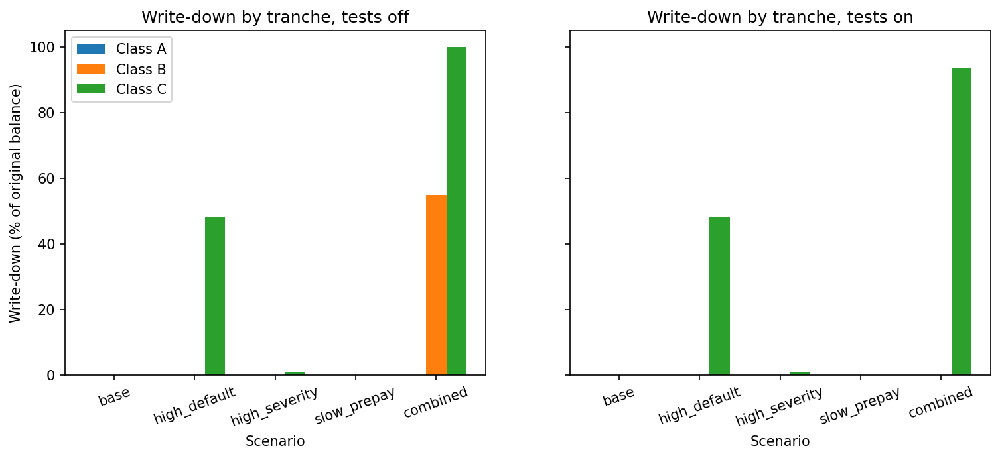

# structured-finance-waterfall

A small teaching model of a securitization: pool cash flows, payment waterfall, coverage tests, stress scenarios, results per tranche. Every input is an illustrative assumption, not a real deal.

## Result



Write-down as % of original balance and weighted average life (WAL) in years, per tranche, per scenario, with the coverage tests off and on:

| scenario      | tests     | A write-down % | A WAL | B write-down % | B WAL | C write-down % | C WAL |
|---------------|-----------|---------------:|------:|---------------:|------:|---------------:|------:|
| base          | tests off |           0.00 |  4.92 |           0.00 | 15.44 |           0.00 | 21.60 |
| base          | tests on  |           0.00 |  4.92 |           0.00 | 15.44 |           0.00 | 21.60 |
| high_default  | tests off |           0.00 |  4.68 |           0.00 | 16.14 |          48.00 | 24.30 |
| high_default  | tests on  |           0.00 |  4.68 |           0.00 | 16.14 |          48.00 | 24.30 |
| high_severity | tests off |           0.00 |  5.05 |           0.00 | 16.22 |           0.72 | 23.67 |
| high_severity | tests on  |           0.00 |  5.05 |           0.00 | 16.22 |           0.72 | 23.67 |
| slow_prepay   | tests off |           0.00 |  8.25 |           0.00 | 22.83 |           0.00 | 27.72 |
| slow_prepay   | tests on  |           0.00 |  8.25 |           0.00 | 22.83 |           0.00 | 27.72 |
| combined      | tests off |           0.00 |  8.62 |          54.76 | 27.21 |         100.00 |   n/a |
| combined      | tests on  |           0.00 |  7.67 |           0.00 | 24.24 |          93.70 | 29.77 |

n/a: class C never receives any principal in that run, so it has no WAL.

Break-even CDR, the lowest annual default rate (0.1% steps, CPR and severity at base) at which a tranche takes its first write-down:

| tranche | tests off | tests on |
|---------|----------:|---------:|
| A       |    14.6 % |   19.1 % |
| B       |     4.8 % |    7.5 % |
| C       |     1.7 % |    1.7 % |

Three findings from the run:

- Base case: no tranche is written down; the total pool loss of $2.57 million is absorbed by the $4 million residual.
- Combined scenario: class B is written down 54.8% with tests off and 0% with tests on, because 142 failed tests redirect $5.85 million of interest to class A principal; class C still loses 93.7%.
- Break-even CDR rises with tests on for class B (4.8% to 7.5%) and class A (14.6% to 19.1%); in the other four scenarios the OC ratio never falls below its starting 111%, so the tests never trip.

## The deal (illustrative)

- Pool: $100,000,000, one representative level-pay loan, 7.00% coupon, 360 months. Servicing fee 0.50% a year on the beginning pool balance.
- Class A $80,000,000 at 5.00%. Class B $10,000,000 at 5.75%. Class C $6,000,000 at 6.50%. Residual $4,000,000, no coupon.
- Recovery lag: 6 months.

Scenarios (CPR / CDR / severity): base 10% / 1% / 35%, high_default 10% / 3% / 35%, high_severity 10% / 1% / 55%, slow_prepay 5% / 1% / 35%, combined 5% / 3% / 55%.

## The rules

Pool, each month in this order: monthly rates SMM = 1 - (1 - CPR)^(1/12) and MDR = 1 - (1 - CDR)^(1/12); defaults = beginning balance x MDR; interest = (beginning balance - defaults) x coupon / 12; scheduled principal from the level-pay formula on the surviving balance and remaining term; prepayment = (surviving balance - scheduled principal) x SMM; loss = defaults x severity, booked now; recovery = defaults x (1 - severity), received 6 months later; ending balance = beginning - defaults - scheduled principal - prepayment.

Waterfall, each month: interest cash pays the servicing fee, then A interest, B interest, C interest, then the rest to the residual; unpaid interest is a shortfall and is not carried forward. Principal cash (scheduled + prepayments + recoveries) pays A until it is gone, then B, then C, then the residual. Write-down: collateral = ending pool balance + recoveries not yet received; if A + B + C exceeds the collateral, the excess is written down from C first, then B, then A.

Coverage tests (tests_on True or False), checked after B interest on beginning-of-month balances: OC = (pool balance + recoveries not yet received) / (A + B), trigger 108%; IC = (pool interest - servicing fee) / (A interest due + B interest due), trigger 125%. If either fails, the interest left after B is added to principal cash (so it pays A first); C interest and the residual get nothing that month, and C records an interest shortfall. If A and B are both zero, both tests pass.

## How to run

```
pip install pandas numpy matplotlib openpyxl pytest jupyter
pytest
jupyter notebook
```

Open 01_how_the_deal_works.ipynb for the workflow one step at a time, then 02_stress_results.ipynb for the five scenarios. Running 02 rewrites results.png and combined_scenario.xlsx.

## Files

- waterfall.py: the DEAL and SCENARIOS dicts and four functions: run_pool, run_waterfall, summarize_tranches, break_even_cdr.
- 01_how_the_deal_works.ipynb: month 1 of the pool and of the waterfall by hand, then all months, then the coverage tests switched on.
- 02_stress_results.ipynb: the five scenarios, tests off and on, ending in the headline table and chart.
- test_waterfall.py: cash in equals cash out; no balance is ever negative; with CPR 0 and CDR 0 the month-1 pool payment is $665,302.50, nothing is written down and every tranche is repaid in full.
- combined_scenario.xlsx: the combined scenario with tests on, one row per month, every pool and waterfall column.
- results.png: the headline chart.

## Limitations

This is a stylized deal with one representative loan and illustrative assumptions. It uses no real deal documents and no rating-agency criteria. It mixes RMBS-style write-downs with CLO-style coverage tests as a teaching simplification. Interest shortfalls are not carried forward, there is no reserve account, no interest-rate risk and no fees other than servicing.
